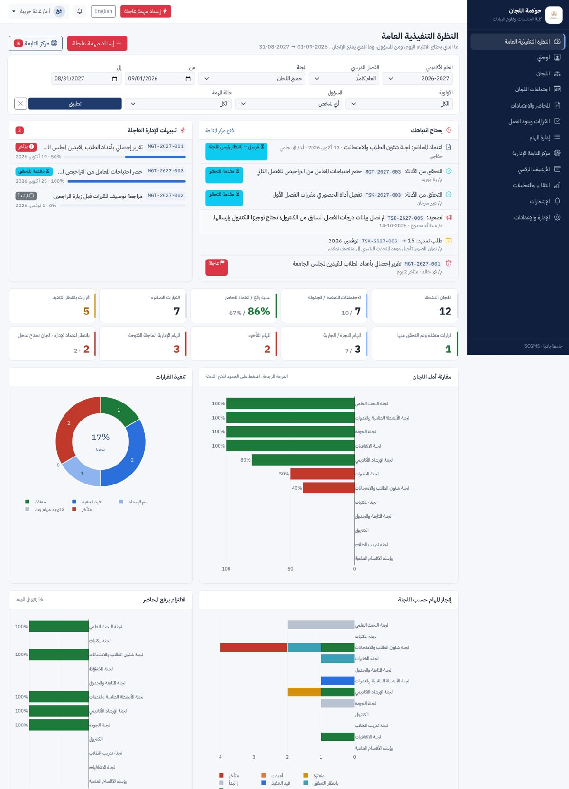
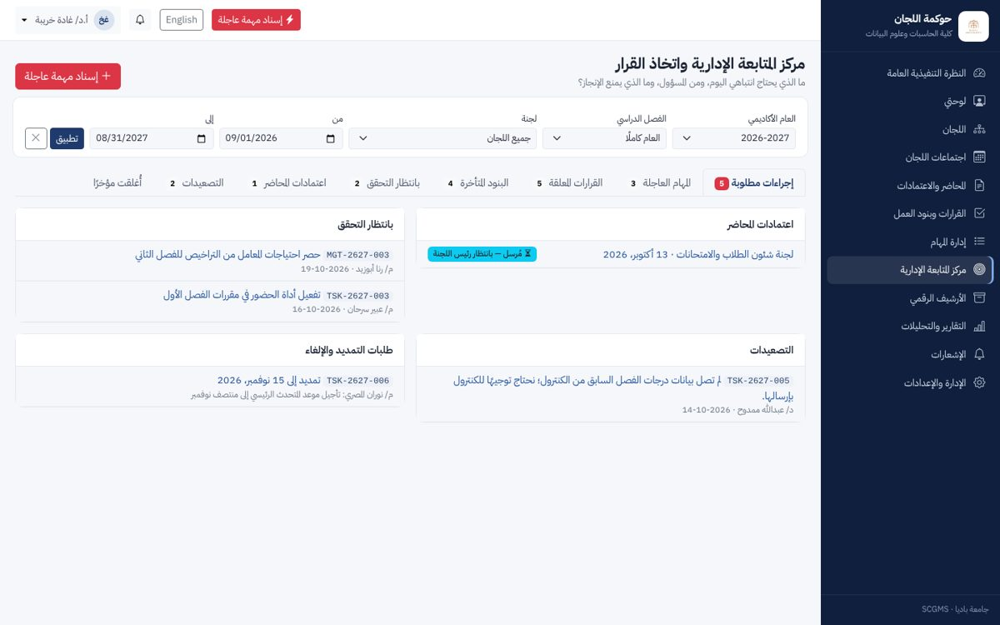
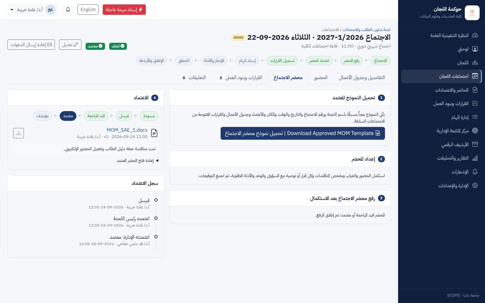
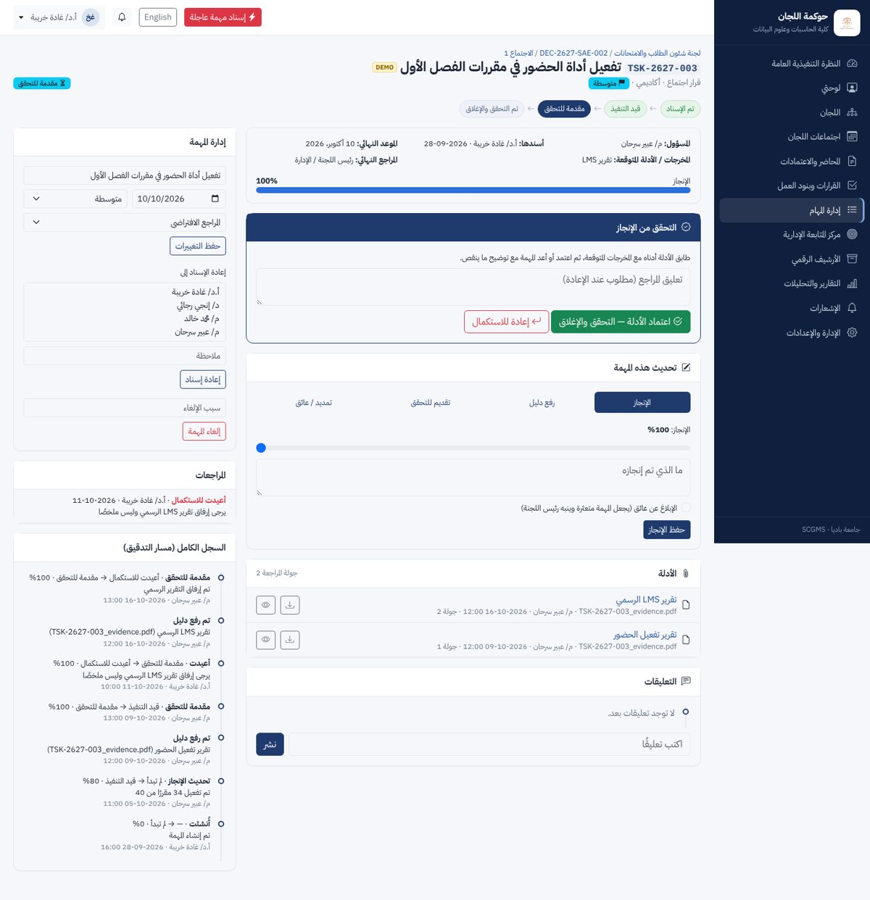
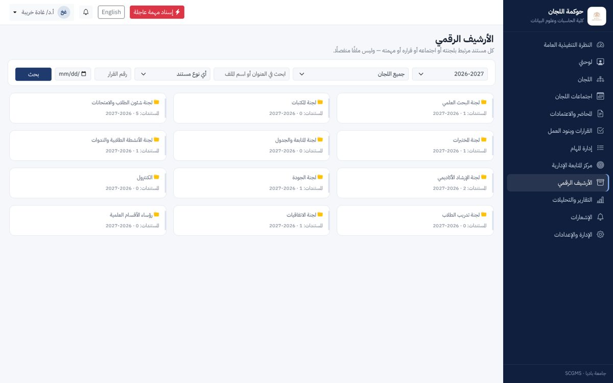
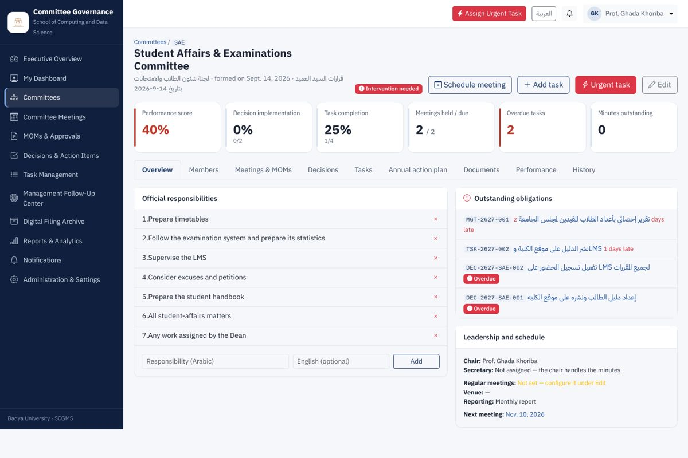

# SCGMS — Smart Committee Governance & Management System
### النظام الذكي لحوكمة وإدارة اللجان

School of Computing and Data Science — Badya University
كلية الحاسبات وعلوم البيانات — جامعة بادية

SCGMS is a bilingual (Arabic / English, full RTL) web system for the Dean and Vice-Dean to govern school committees. It follows every decision through to verified closure:

```
Meeting → MOM submission → MOM approval → Decision registration → Task assignment
        → Progress → Evidence → Verification → Closure → Archive
```

| Area | What it does |
|---|---|
| Executive Overview | KPI tiles, 9 charts (performance comparison, decision status, task completion, MOM compliance, heatmap, trend, calendar, overdue list, scorecards), filters by year / semester / committee / dates / priority / person / status |
| Committees | Formation, chair / secretary / members with full membership history, responsibilities, annual action plan, performance scorecard |
| Meetings & MOMs | Scheduling (single or a whole year of regular meetings), invitations, attendance, auto-filled MOM template **(تحميل نموذج محضر الاجتماع المعتمد)**, upload of the completed MOM **(رفع محضر الاجتماع بعد الاستكمال)**, approval route Draft → Submitted → Under review → Revision / Approved → Archived |
| Decisions & Action Items | Decision register with IDs, conversion into tasks, pending decisions from previous meetings, cancellation / supersession with management approval |
| Tasks | Committee tasks and **urgent management tasks**, progress, evidence upload, verification, extension requests, escalation, reassignment |
| Management Follow-Up Center | Action required, urgent tasks, pending decisions, overdue items, pending verification, MOM approvals, escalations, recently closed |
| Digital Filing Archive | Year → committee → formation / plan / meetings / MOM / decisions / tasks / evidence / reports; versioning, locking of approved records, search, ZIP export per committee |
| Reports | 8 management reports, each exportable to PDF (Arabic-shaped) and Excel |
| Notifications | In-app with badge; optional e-mail; daily reminders, escalation after N overdue days, de-duplicated |
| Security | Role-based access (Dean, Vice-Dean, Chair, Secretary, Member, System Administrator), per-committee roles, private file storage with permission-checked downloads, upload type / size / content checks, audit log of every significant action |

---

## Quick start A — Docker (recommended for the server)

Requirements: a Linux server with Docker Engine and the Compose plugin.

```bash
unzip scgms.zip && cd scgms
cp .env.example .env
nano .env                 # set DJANGO_SECRET_KEY, POSTGRES_PASSWORD, DJANGO_ALLOWED_HOSTS, SITE_URL
docker compose up -d --build
```

Open `http://<server-address>/`. The first start creates the database, loads the 12 committees and 25 staff members, and creates the administrator account.

To include the DEMO sample meetings, decisions and tasks on the first start, set `LOAD_DEMO_DATA=1` in `.env` before running `docker compose up` the first time.

HTTPS, backups, e-mail and updates: see **[docs/DEPLOYMENT.md](docs/DEPLOYMENT.md)**.

## Quick start B — without Docker (a laptop or a trial)

Requires Python 3.11+.

```bash
cd scgms
python -m venv .venv && source .venv/bin/activate      # Windows: .venv\Scripts\activate
pip install -r requirements.txt
export DJANGO_DEBUG=1                                   # Windows: set DJANGO_DEBUG=1
python manage.py bootstrap --demo                       # database + school data + demo data
python manage.py runserver
```

Open http://127.0.0.1:8000/. Without `DATABASE_URL` the system uses a local SQLite file in `data/`, and reminders run through `python manage.py send_reminders` (schedule it daily with cron or Windows Task Scheduler).

## First login

| Account | Username | Initial password |
|---|---|---|
| System administrator | `admin` | `ChangeMe@2026` |
| Dean — Prof. Mohamed Helmy Khafagy | `mkhafagy` | `ChangeMe@2026` |
| Vice-Dean — Prof. Ghada Khoriba | `gkhoriba` | `ChangeMe@2026` |
| Every other staff member | see *Administration → Users* | `ChangeMe@2026` |

Everyone is asked to choose a new password at the first login. **Change the administrator password immediately.**

## Demo data

All sample records are flagged **DEMO** (yellow tag on screen). Remove them in one step. Real committees, members and anything you entered yourself are kept.

```bash
docker compose exec web python manage.py purge_demo      # Docker
python manage.py purge_demo                              # without Docker
```

## Tests

```bash
python manage.py test apps
```

There are 24 tests, covering:

- the 15-step acceptance scenario end-to-end through the web pages;
- the urgent-task flow;
- role and committee isolation;
- the evidence and verification rules;
- extensions and escalations;
- reminder de-duplication;
- upload security;
- the KPI formulas;
- every page rendered in Arabic and English.

## Documentation

* [docs/USER_GUIDE.md](docs/USER_GUIDE.md): how each role uses the system (Arabic and English).
* [docs/ADMIN_GUIDE.md](docs/ADMIN_GUIDE.md): users, committees, the MOM template, settings, KPI weights, academic years.
* [docs/DEPLOYMENT.md](docs/DEPLOYMENT.md): server installation, HTTPS, e-mail, backups, updates.
* [docs/ARCHITECTURE.md](docs/ARCHITECTURE.md): data model, workflow rules, permission matrix, KPI formulas, MOM template placeholders.

## Technology

Django 5.2 · PostgreSQL 16 (SQLite for trials) · Bootstrap 5.3 RTL · HTMX · Plotly · FullCalendar · python-docx · openpyxl · ReportLab (Arabic shaping) · Celery + Redis · gunicorn · nginx · Docker Compose. All front-end libraries are bundled locally, so the system runs without internet access.

## Screenshots

| | |
|---|---|
|  |  |
|  |  |
|  |  |
