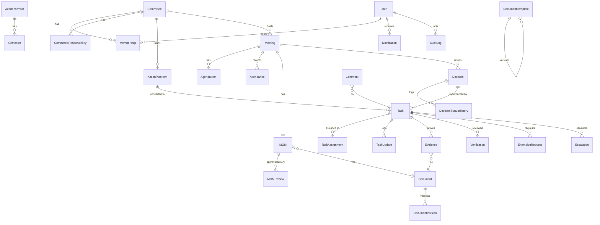

# Architecture and rules

## Project layout

```
config/            settings (all values from environment), urls, celery (daily reminder schedule)
apps/accounts      User (school role), login, forced password change, profile, user administration
apps/core          academic years, semesters, settings, audit log, notifications, comments,
                   permissions.py (every access rule), reminders.py, executive overview,
                   follow-up center, my dashboard, calendar, administration screens
apps/committees    committees, memberships (with history), responsibilities, action plan,
                   meetings, agenda, attendance, MOM + MOM review history; seed and demo commands
apps/governance    decisions, tasks, assignments, updates, evidence, verification,
                   extension requests, escalations — services.py holds the workflow
apps/documents     private document store with versions + SHA-256, MOM template engine,
                   archive, ZIP export
apps/reports       kpi.py (documented formulas), the 8 reports, PDF / Excel export
templates/ static/ Bootstrap 5 RTL UI, Plotly charts, FullCalendar, HTMX notification badge
locale/ar          Arabic translation of the interface
```

All state changes go through **service functions** (`apps/*/services.py`). The views stay thin. Each service function does four things, inside one database transaction:

1. checks the permission;
2. validates the workflow state;
3. writes an audit log entry;
4. sends the notifications.

## Data model (28 entities)



Entities by app:

* **Accounts and core:** User, AcademicYear, Semester, SystemSettings, AuditLog, Comment, Notification.
* **Committees:** Committee, CommitteeResponsibility, Membership, ActionPlanItem, Meeting, AgendaItem, Attendance, MOM, MOMReview.
* **Governance:** Decision, DecisionStatusHistory, Task, TaskAssignment, TaskUpdate, Evidence, Verification, ExtensionRequest, Escalation.
* **Documents:** Document, DocumentVersion, DocumentTemplate.

Identifiers:

* Decisions are numbered `DEC-<yy><yy>-<COMMITTEE>-NNN`, for example `DEC-2627-SAE-001`.
* Committee tasks are numbered `TSK-2627-NNN`.
* Urgent management tasks are numbered `MGT-2627-NNN`.

## Status rules

**MOM:** `draft → submitted → under_review → approved → archived`. A chair or management return sets it to `revision`, and it becomes `submitted` again on re-upload.

* If the chair uploads the minutes, the chair stage is passed immediately.
* If *management approval* is switched off, the chair's approval sets the MOM to `approved`.
* Approval locks the document.
* The MOM is archived once none of its decisions is still open.
* Only management can reopen approved minutes, and a reason is required and logged.

**Decision:** `registered → assigned → in_progress → implemented`, plus `noted` (non-actionable), `cancelled` and `superseded`.

* Decisions can be registered only from **approved** minutes.
* A decision is `implemented` only when every non-cancelled task is `verified`.
* Cancellation and supersession are *requested* by the committee and *approved* by the Dean or Vice-Dean.

**Task:** `not_started → in_progress / blocked → submitted → verified`. The other states are `returned`, which leads back to submitted, and `cancelled`.

* Submission requires at least one evidence file uploaded in the current review round.
* Verification is done by the reviewer: the chosen reviewer if one is set; otherwise the committee chair, or management for management tasks.
* Management can always verify.
* **Nobody can verify a task they are assigned to.**
* Verified tasks are read-only, and their evidence files are locked.

## Permission matrix

| Action | Dean / Vice-Dean | Chair | Secretary | Member | Sys-Admin |
|---|---|---|---|---|---|
| Executive overview, all committees (read) | ✔ | — | — | — | ✔ |
| Management Follow-Up Center | ✔ | — | — | — | — |
| View own committee workspace | ✔ | ✔ | ✔ | ✔ | ✔ |
| Establish / edit committee, set members | ✔ | — | — | — | ✔ |
| Schedule meetings, attendance, upload MOM | ✔ | ✔ | ✔ | — | — |
| Chair MOM approval | if no chair | ✔ | — | — | — |
| Final MOM approval / reopen | ✔ | — | — | — | — |
| Register decisions (approved MOM) | ✔ | ✔ | ✔ | — | — |
| Convert decision to tasks, create committee tasks | ✔ | ✔ | — | — | — |
| Assign urgent management tasks | ✔ | — | — | — | — |
| Update progress / upload evidence / submit | ✔ | ✔ | ✔ | own tasks | — |
| Verify committee tasks | ✔ | ✔ (not own) | — | — | — |
| Verify management tasks | ✔ | — | — | — | — |
| Decide extensions, reassign, change deadline | ✔ | ✔ (committee tasks) | — | — | — |
| Approve decision cancellation | ✔ | — | — | — | — |
| Confidential documents | ✔ | — | — | — | — |
| Users, policy settings, KPI weights, MOM template | ✔ (not users) | — | — | — | ✔ |
| Reports and exports | ✔ (all) | own committees | own committees | own committees | ✔ |

Committee roles are per committee, so the same person can be chair of one committee and member of another. All checks live in `apps/core/permissions.py` and are enforced on the server for every page, action and file download.

## KPI formulas

Every rate is *numerator ÷ denominator* over the selected period. It counts only items **due** by the cut-off date, which is the earlier of the period end and today.

| Indicator | Formula | Default weight |
|---|---|---|
| Meeting compliance | meetings held ÷ meetings scheduled up to the cut-off (cancelled excluded) | 15 |
| MOM submission compliance | MOMs submitted within the grace period ÷ held meetings whose MOM is due | 15 |
| Decision implementation | actionable decisions implemented & verified ÷ actionable decisions due | 30 |
| Task completion | tasks verified ÷ tasks due (cancelled excluded) | 20 |
| On-time completion | tasks verified on or before their deadline ÷ tasks due | 20 |
| Overdue tasks | open tasks past their deadline (count, shown separately) | — |
| Decision closure time | average days from registration to verified closure | — |

**Overall score** is the weighted average of the rates that have something due. A rate with nothing due is left out, and the remaining weights are re-scaled. Volume never raises the score.

Health levels:

* **Intervention needed** when anything is overdue or the score is below 60.
* **Needs attention** when the score is below 80 or nothing is due yet.
* **On track** otherwise.

## Notifications and reminders

`apps.core.services.notify()` writes an in-app notification for each recipient. It skips duplicates that share a `dedupe_key` within a time window, and queues an e-mail when e-mail is enabled. The daily job in `apps.core.reminders.run_daily_reminders()` runs on Celery beat, or through `manage.py send_reminders` on cron. It covers:

* meetings in N days;
* MOM due or overdue;
* tasks due soon or overdue;
* escalation to management after N overdue days;
* overdue decisions;
* the daily digest.

## Security

* Authentication is required on every page. Users must change their initial password.
* Sessions expire after 10 hours.
* CSRF protection is on all forms.
* With HTTPS enabled: secure cookies and HSTS.
* `nosniff` is set, and frames are limited to the same origin.
* Uploaded files live outside the web root, under `MEDIA_ROOT`. They are streamed only by `documents:download` after `can_view_document`.
* Uploads are checked by extension allow-list, by size limit, and by content signature (magic bytes) matching the extension.
* Every file version stores a SHA-256 checksum.
* Approved records are locked against replacement.
* Every significant action is written to the append-only audit log.
* The application refuses to start in production with the development secret key.

## Translations

Interface strings use Django i18n. Arabic translations are in `locale/ar/LC_MESSAGES/django.po`. After changing texts, run:

```bash
python manage.py makemessages -l ar --ignore=staticfiles --ignore=data
# translate the new entries in django.po
python manage.py compilemessages -l ar
```

Data fields that users type have Arabic and English columns (committee names, responsibilities, notification titles, audit messages), and the interface shows the column for the current language.
